# exploratory_pca_clustering_ilia

Exploratory PCA and clustering of the **ILIA 2026 subindicators** (126 subindicators × 20 Latin American and Caribbean countries).
The study looks at how countries behave on the raw subindicators, **before any aggregation into the index**:
which directions separate them, whether they form groups, and how much of that depends on imputed data.

## Questions

1. What are the main directions of variation across countries, and which subindicators drive them?
2. Do countries form distinct groups (typologies), and how stable are those groups?
3. How much do the results change when imputed values are left out, or when redundant subindicators are removed?

## Summary

* **The gaps are not random.** Countries with more imputed cells score lower on what is observed (Spearman ρ = −0.79).
* **PC1 is overall level** (36–39% of variance). Only PC1 and PC2 stand out from noise.
* **PC2 contrasts national AI strategy and institutions with infrastructure, data, talent and adoption.**
  Cuba, El Salvador and the Dominican Republic lean to strategy; Trinidad and Tobago, Paraguay, Panama and Chile lean to capabilities.
* **The robust grouping is a split by level:** upper {ARG, BRA, CHL, COL, CRI, ECU, MEX, PER, URY} and lower
  {BOL, CUB, SLV, GTM, HND, JAM, PRY, TTO, VEN}. The Dominican Republic and Panama are borderline.
* **With real data only, four groups appear:** leaders (BRA, CHL, URY), upper-middle, lower, and
  *strategy ahead of capabilities* (CUB, SLV, DOM).
* **There are no distinct profile types.** Once level is removed, countries form a gradient, not clusters.
* **Imputation and pruning barely change the level picture.** At k = 2, real-data-only and imputed data give identical groups.

---

## Data

`data/raw/ilia_2026_resultados_consolidados.xlsx` has three aligned sheets:

* `bruto`: raw values, with empty cells where no data exists;
* `normalizado`: an intermediate normalization step;
* `final`: 0–100 scores, with the empty cells imputed using MICE with Bayesian ridge and auxiliary predictors
  (GDP, population, 10-year GDP growth and others).

A `final` value is imputed exactly when the same `bruto` cell is empty. **All 20 countries are kept in every analysis.**

## Configurations

|  | **all subindicators** | **pruned** (redundancy removed at Spearman \|ρ\| ≥ 0.9) |
|---|---|---|
| **A: real data only** (subindicators with no gaps) | A-full: 86 | A-pruned: 70 |
| **I: MICE-imputed `final` sheet** | I-full: 126 | I-pruned: 106 |

Each configuration is analysed in two views:

* **level**: standardized scores (z-scores);
* **profile**: each country's mean z-score removed, leaving its pattern of relative strengths and weaknesses.

Subindicators are referred to by short codes `<DIM>.<SUBDIM>.<nn>` (e.g. `FH.INF.19`); [`data/processed/codebook.csv`](data/processed/codebook.csv)
maps them to names. Dimensions: **FH** enabling factors, **GOB** governance, **IDA** R&D and adoption.

## Method in brief

* **Pruning:** Spearman correlation on real data only, pair by pair. Subindicators are grouped by complete linkage so that every pair in a group
  has |ρ| ≥ 0.9, and one per group is kept, preferring the most complete. One list is applied to both A and I.
* **PCA** on z-scores. Horn's parallel analysis (1,000 column permutations, 95th percentile) decides how many components are above noise.
* **Clustering** on the retained component scores. **Ward** hierarchical clustering is the main method, with **k-means** as a check
  (Adjusted Rand Index, ARI). k is chosen by silhouette among solutions with no single-country cluster. The **gap statistic**, including
  k = 1, tests whether clusters exist at all.
* **Stability:** 1,000 bootstrap resamples of countries give a Jaccard score per cluster (> 0.75 stable, 0.6–0.75 a pattern, < 0.5 dissolves)
  and a country co-membership matrix.
* **Comparisons:** Procrustes-aligned maps (how far each country moves), Tucker congruence of loadings, and ARI between partitions.

---

## Results

### 1. Where the gaps are, and why it matters

141 of the 2,520 cells (5.6%) are imputed. 86 of the 126 subindicators are complete for all 20 countries; these form A-full.

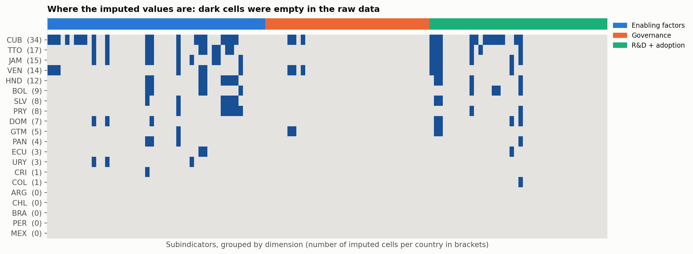

* **By country:** five countries have no gaps (ARG, BRA, CHL, MEX, PER). Cuba has 34 (27% of its row), then Trinidad and Tobago 17,
  Jamaica 15 and Venezuela 14.
* **By dimension:** the gaps sit in FH (84 cells) and IDA (49); governance has only 8. A therefore leans towards governance:
  34 of its 86 subindicators (40%), against 37 of 126 (29%) in I. Of the 37 governance subindicators, 24 are categorical
  (2–3 values, typically whether a strategy, budget or institution exists).

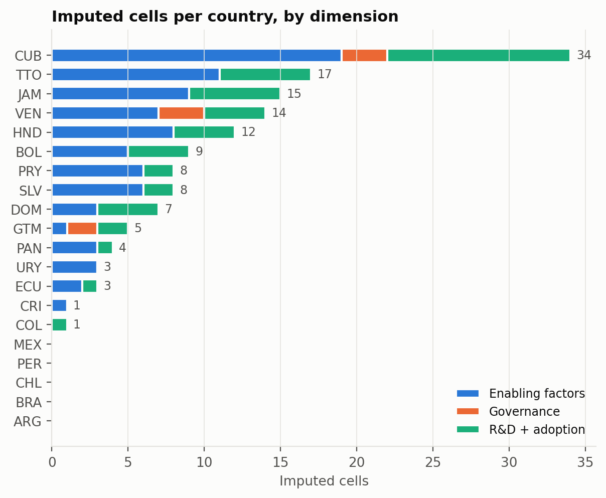

**The gaps are not random.** Countries with more imputed cells score lower on the 86 subindicators that are observed for everyone
(Spearman ρ = −0.79, p < 0.001). The missing information belongs to the lower-scoring countries. A leaves it out; I fills it with values
predicted partly from GDP, population and growth. Neither choice is neutral, which is why both are analysed.

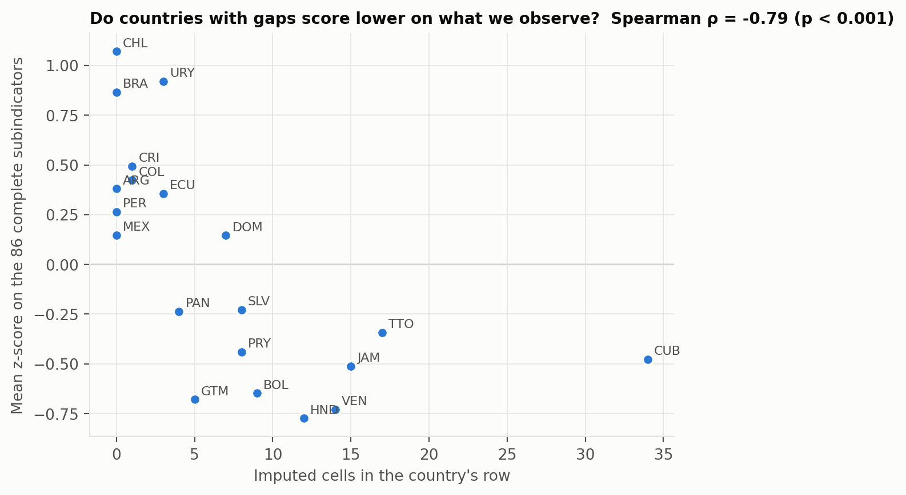

> English proficiency for Jamaica and Trinidad and Tobago is empty in `bruto` and was set to 100 by hand in `final`.
> It counts as imputed here, so it is absent from A and present in I.

### 2. Redundant subindicators

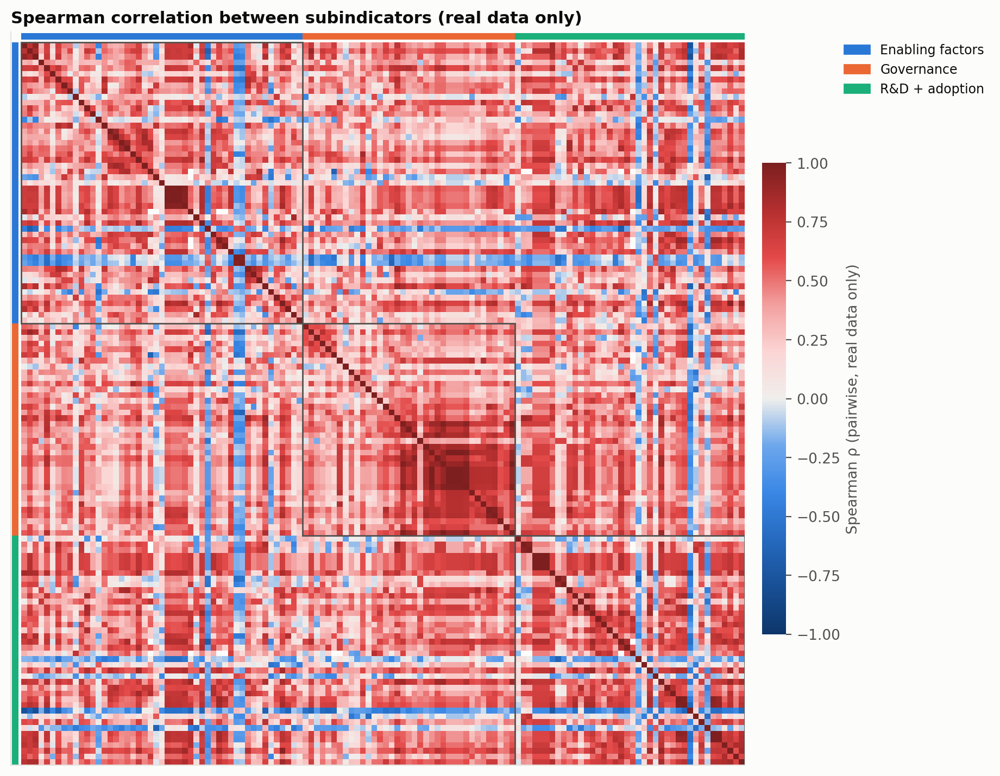

Correlations are mostly positive: countries that score well on one subindicator tend to score well on others.
**A few subindicators run against the general level** (the blue stripes): researcher productivity (IDA.INV.03),
relative IXP interconnection (FH.INF.25), English proficiency (FH.TAL.04/05), open-source productivity (IDA.IDI.08)
and the share of women AI authors (IDA.INV.06). These are mostly ratios where small or low-output countries score high.
The values were checked against the source data and kept.

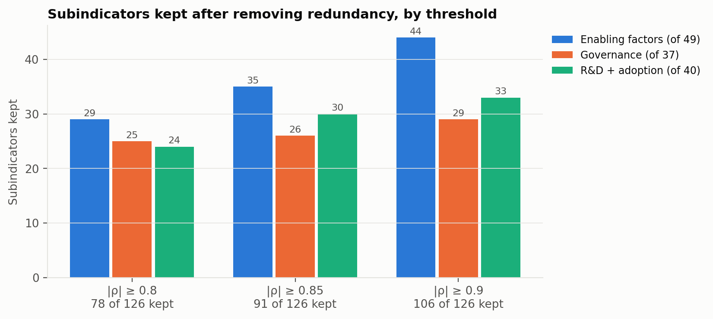

**At |ρ| ≥ 0.9, 20 subindicators fall into 13 redundant groups**, leaving 106 (I-pruned), 70 of them with no gaps (A-pruned).
Lower thresholds remove much more (91 kept at 0.85, 78 at 0.8). The groups are intuitive:

* GPU memory, capacity and count, with CPU capacity;
* AI adoption in large, medium and small firms (ρ = 1.00, effectively one variable);
* English proficiency overall and for women;
* consistent AI research overall and by women authors;
* AI publications and active AI researchers;
* the yes/no national-strategy topic flags, which collapse into a few groups.

One group crosses dimensions: AI master's programmes (FH.TAL.12) with participation in side tracks (IDA.INV.10).
The full lists are in [`results/pruning/`](results/pruning/).

### 3. Principal components

| configuration | subindicators | PCs above noise | PC1 | PC2 | PC1+PC2 |
|---|---:|---:|---:|---:|---:|
| A-full · level | 86 | 2 | 39.5% | 11.5% | 51.0% |
| A-pruned · level | 70 | 2 | 35.6% | 11.3% | 46.9% |
| I-full · level | 126 | 2 | 39.3% | 10.2% | 49.5% |
| I-pruned · level | 106 | 2 | 37.5% | 10.1% | 47.6% |
| A-full · profile | 86 | 4 | 17.2% | 12.3% | 29.4% |
| I-full · profile | 126 | 4 | 15.5% | 13.0% | 28.4% |

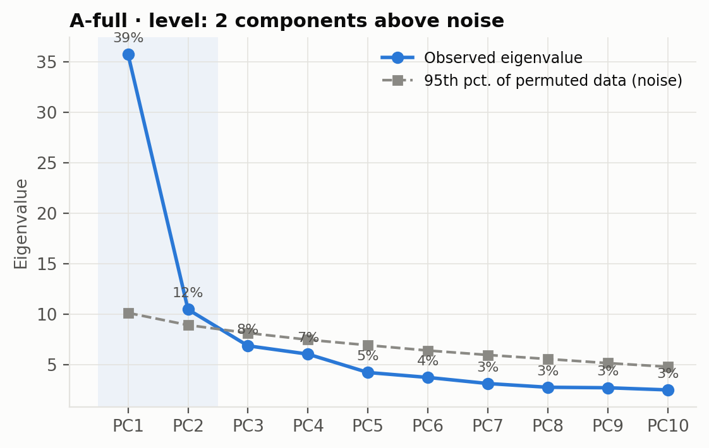

**PC1 is each country's overall level.** About 95% of subindicators load positively on it, and its scores correlate 0.997–0.998 with
the country's mean z-score in every configuration. Ordering countries on PC1 is essentially ranking them by their average.
**Only two components stand out from noise**: after PC2, components are indistinguishable from what shuffled data produce with 20 countries.

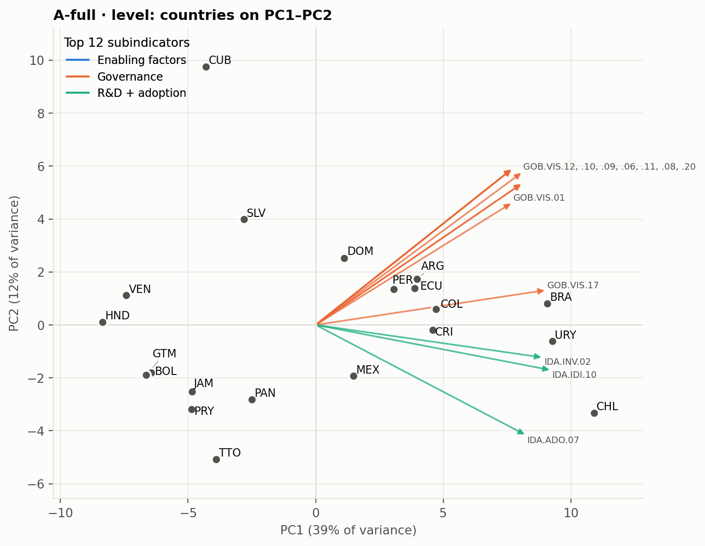

**PC2 contrasts national AI strategy and institutions with capabilities.** The arrows show the 12 subindicators most associated with the
plane. The strategy topic flags (GOB.VIS) point up; R&D and adoption (consistent research, software developers, digital government) point down.
Cuba is the extreme on the strategy side, followed by El Salvador and the Dominican Republic. Trinidad and Tobago, Paraguay, Panama and Chile
lean to the capabilities side.

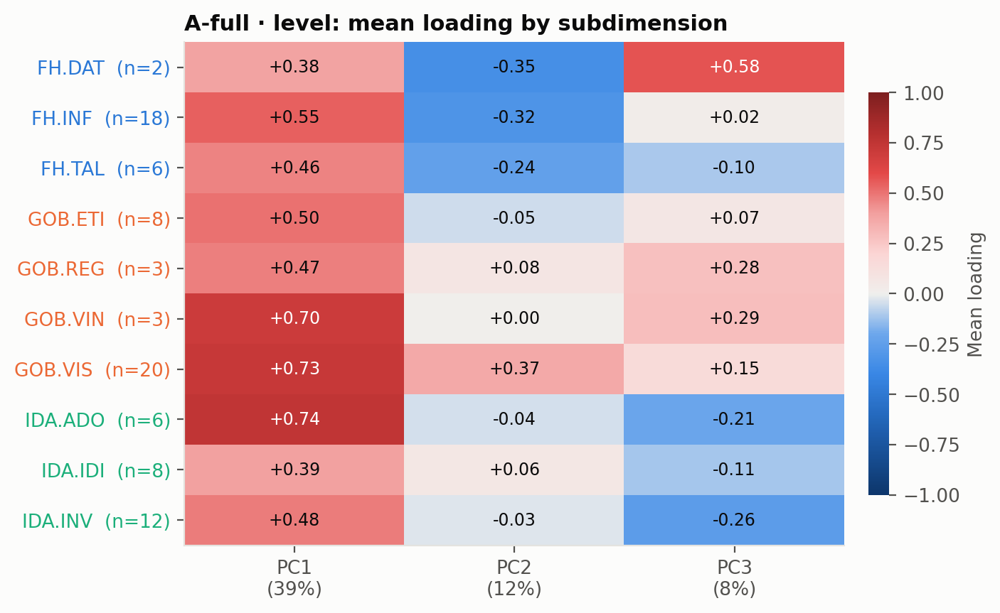

By subdimension, every block loads positively on PC1. On PC2, strategy and institutions (GOB.VIS +0.37) are set against
infrastructure (−0.32), data (−0.35) and talent (−0.24).

The imputed data give the same structure; the sign of PC2 is arbitrary and flips:

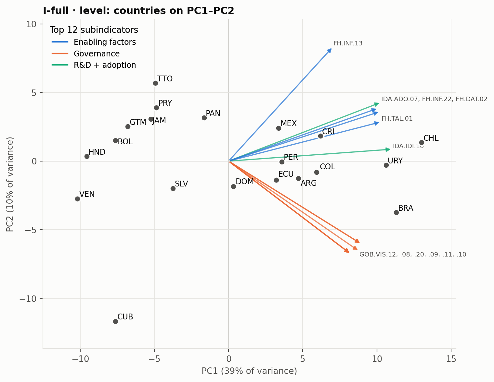

**Profile view.** With the overall level removed, the variance spreads out (PC1 15–17%, 3–4 components above noise). The main axis is again
strategy against capabilities, here basic connectivity and its affordability: 3G coverage, fixed latency, and the cost of fixed and mobile broadband.
The second axis is **research depth** (consistent AI research), which pulls Brazil, Chile and Uruguay away from the rest.

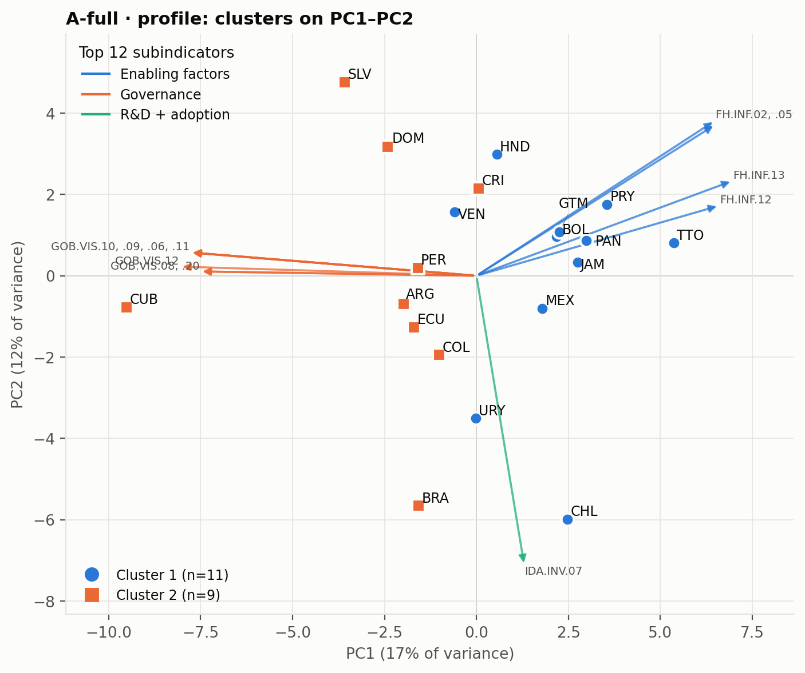

### 4. Clusters

| configuration | k chosen | k by gap rule | Ward silhouette | mean Jaccard | sizes |
|---|---:|---:|---:|---:|---|
| A-full · level | 4 | 2 | 0.53 | 0.83 | 8/6/3/3 |
| A-pruned · level | 2 | 2 | 0.52 | 0.95 | 10/10 |
| I-full · level | 2 | 2 | 0.51 | 0.91 | 11/9 |
| I-pruned · level | 2 | 1 | 0.49 | 0.86 | 11/9 |
| A-full · profile | 2 | 1 | 0.24 | 0.66 | 11/9 |
| A-pruned · profile | 2 | 1 | 0.53 | 0.81 | 19/1 |
| I-full · profile | 2 | 1 | 0.20 | 0.62 | 11/9 |
| I-pruned · profile | 2 | 1 | 0.19 | 0.57 | 11/9 |

#### Level view: a robust split by overall level

In all four configurations the countries divide into an **upper half** {ARG, BRA, CHL, COL, CRI, ECU, MEX, PER, URY} and a
**lower half** {BOL, CUB, SLV, GTM, HND, JAM, PRY, TTO, VEN}. k-means agrees with Ward (ARI 0.62–1.00).

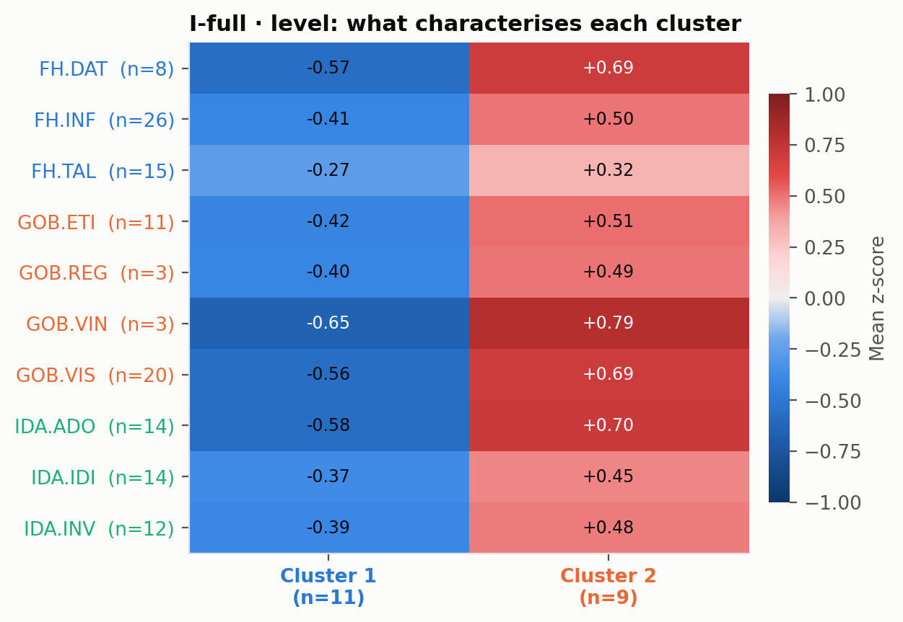

The two halves differ on every subdimension at once, as expected from a split driven by PC1. The gap is widest in international
engagement (GOB.VIN), adoption (IDA.ADO), data (FH.DAT) and national strategy (GOB.VIS).

**Borderline countries:** the Dominican Republic (negative silhouette in A-full and I-full; it joins the upper half in both pruned versions)
and Panama (upper half in I-pruned).

#### A finer reading with real data only: four groups

A-full gives its best silhouette at k = 4 (0.53 against 0.50 at k = 2). The margin is small and the gap rule prefers 2, but the four groups are readable:

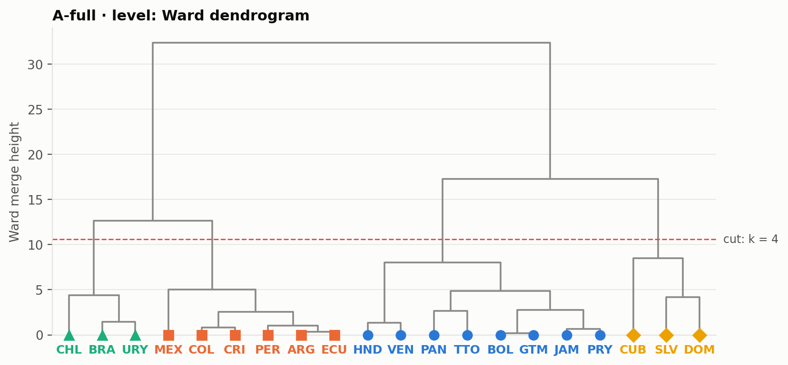

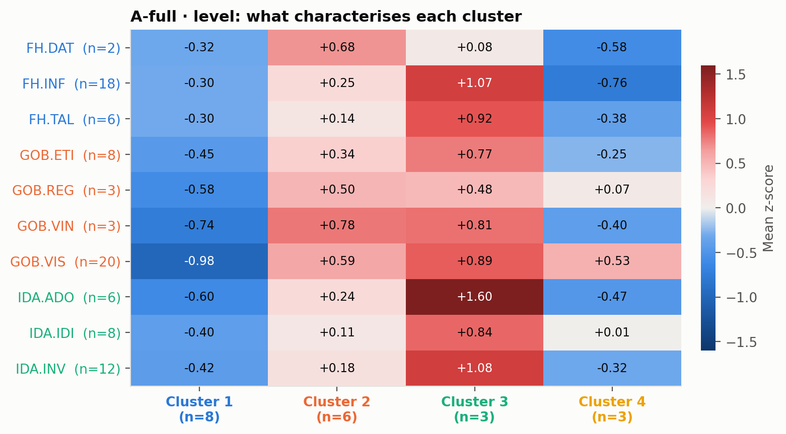

| cluster | countries | profile | stability (Jaccard) |
|---|---|---|---:|
| 3 · leaders | BRA, CHL, URY | above average everywhere, especially adoption (+1.60), research and infrastructure | 0.92 |
| 2 · upper-middle | ARG, COL, CRI, ECU, MEX, PER | above average and fairly even | 0.83 |
| 1 · lower | BOL, GTM, HND, JAM, PAN, PRY, TTO, VEN | below average everywhere, weakest on national strategy (−0.98) | 0.91 |
| 4 · strategy ahead of capabilities | CUB, SLV, DOM | above average on strategy (GOB.VIS +0.53), below on infrastructure (−0.76) and data | 0.67 |

The strategy group is the **second split** of the dendrogram: it separates from the lower half before the leaders separate from the upper-middle group.
Following the clusters from k = 2 to k = 6 shows the order in which groups split:

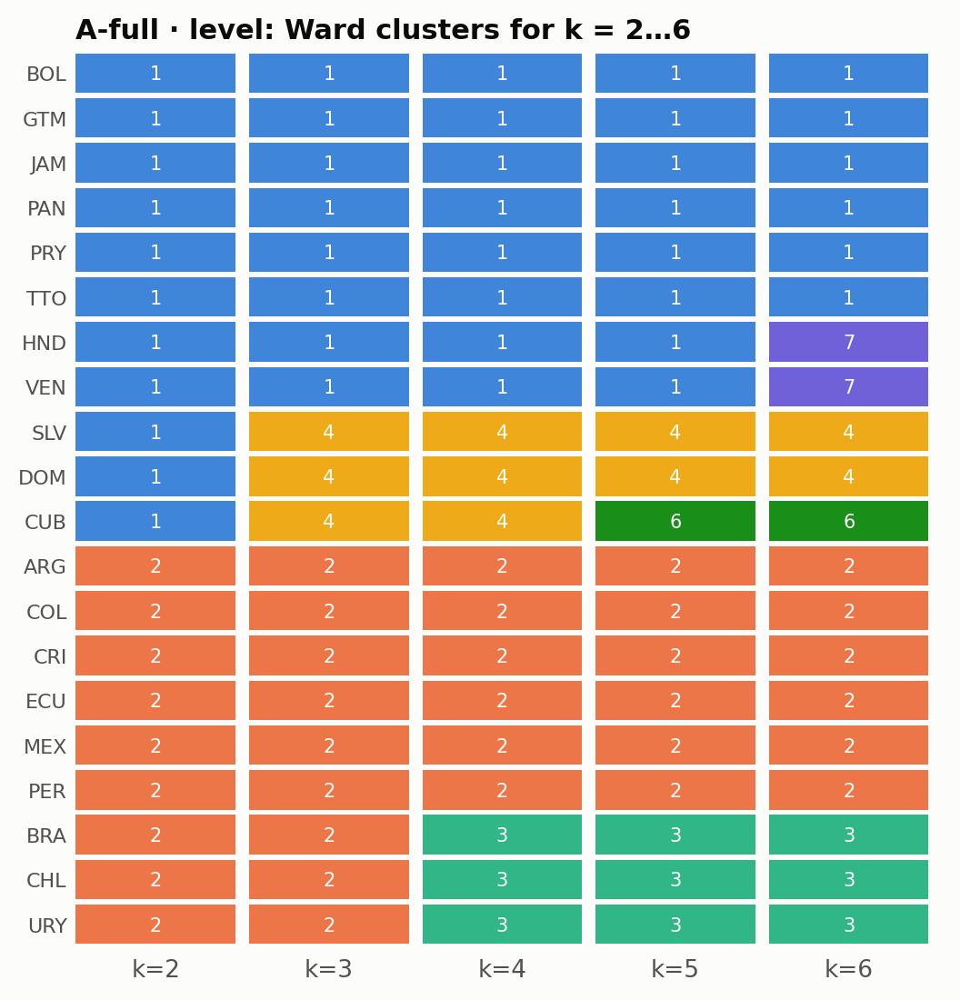

The bootstrap shows the leaders, upper-middle and lower groups are solid. The strategy group holds Cuba and El Salvador together,
while the Dominican Republic often moves to the upper-middle group:

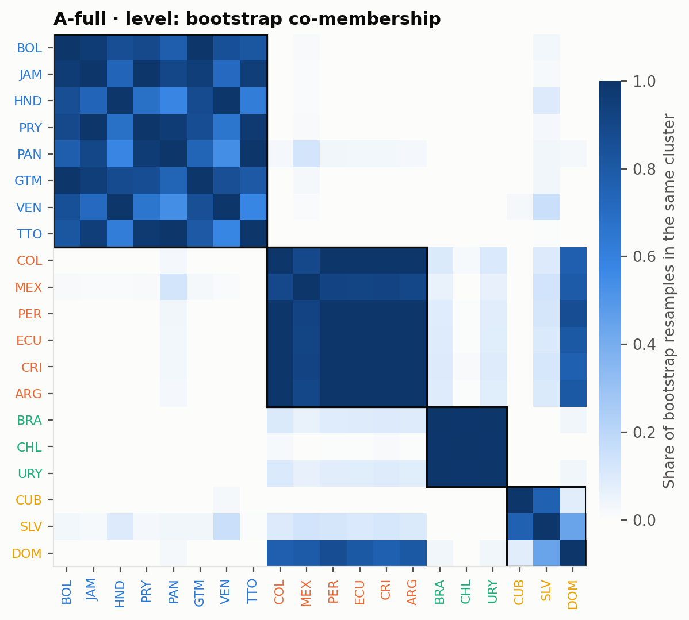

#### Profile view: a gradient, not clusters

The gap statistic prefers **k = 1** in every profile run, silhouettes are 0.19–0.24 and Jaccard is about 0.6. The k = 2 split still has a
readable content, the same strategy-versus-capabilities contrast as PC2: relatively stronger on strategy
{ARG, BRA, COL, CRI, CUB, ECU, SLV, PER, DOM}, against relatively stronger on capabilities {BOL, CHL, GTM, HND, JAM, MEX, PAN, PRY, TTO, URY, VEN}.
It is best read as a position along a continuum. In A-pruned, Cuba alone separates from everyone else (19/1).

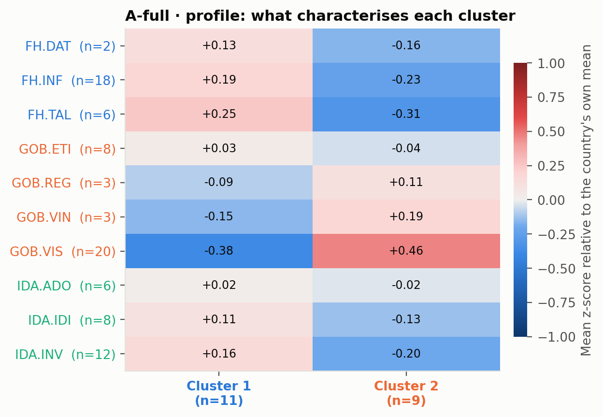

### 5. Real vs imputed data, full vs pruned

**What A → I measures.** The 86 subindicators in A have no imputed cells, so they are identical in I. The difference between A and I is the effect of
**adding the 40 subindicators that have gaps**, new variables and their imputed values together.

| comparison | Procrustes disparity | ρ(displacement, imputed cells) | PC1 congruence | PC2 congruence |
|---|---:|---:|---:|---:|
| A-full → I-full · level | 0.035 | −0.23 | 0.998 | 0.949 |
| A-pruned → I-pruned · level | 0.035 | 0.01 | 0.999 | 0.962 |
| A-full → A-pruned · level | 0.029 | 0.03 | 0.996 | 0.940 |
| I-full → I-pruned · level | 0.022 | 0.13 | 0.998 | 0.955 |
| A-full → I-full · profile | 0.224 | 0.14 | 0.857 | 0.521 |
| A-pruned → I-pruned · profile | 0.101 | 0.13 | 0.798 | 0.627 |

Disparity: 0 = identical maps, 1 = unrelated. Congruence: > 0.95 same component, 0.85–0.95 similar, < 0.85 different.

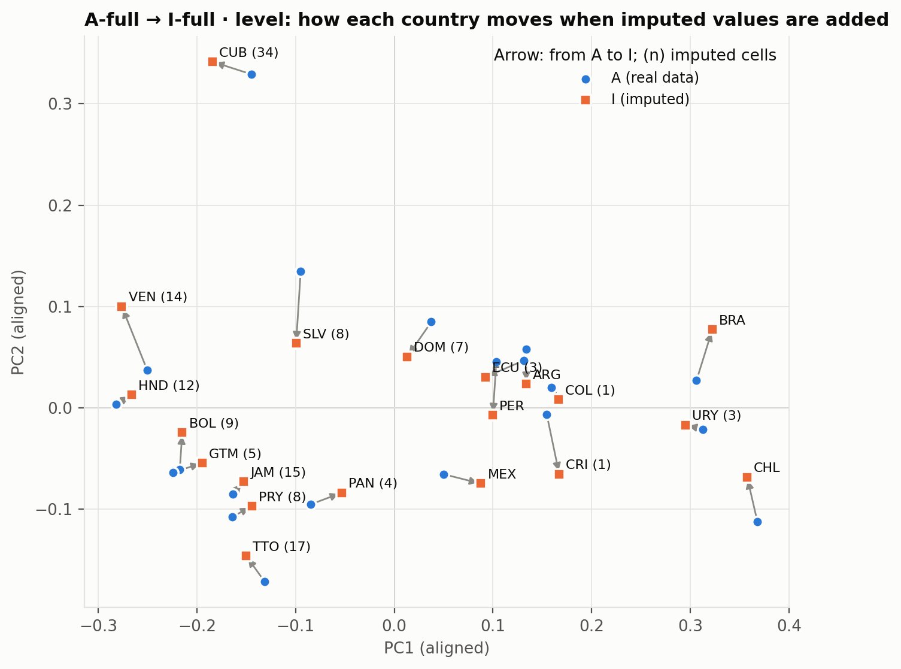

* **Level view: imputation barely changes the picture.** The aligned maps are almost the same and the components keep their meaning.
* **How far a country moves does not depend on how much of its row is imputed.** Venezuela and El Salvador move most (about 0.07),
  but Costa Rica, with one imputed cell, moves almost as much. Cuba, with 34 imputed cells, stays at the strategy extreme.

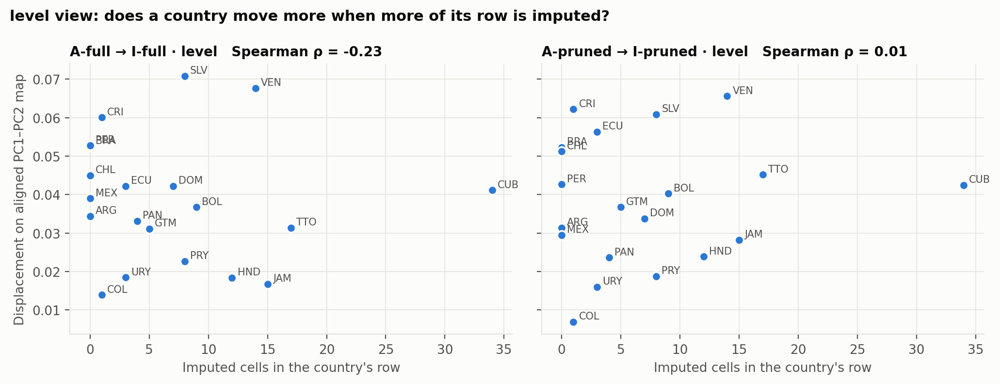

* **At a common k = 2 the partitions agree:** A-full and I-full are identical (ARI 1.00). The pruned versions differ only on the
  Dominican Republic (both) and Panama (I-pruned). The matrix below compares each run at its own chosen k, so A-full (k = 4) looks less similar than it is.

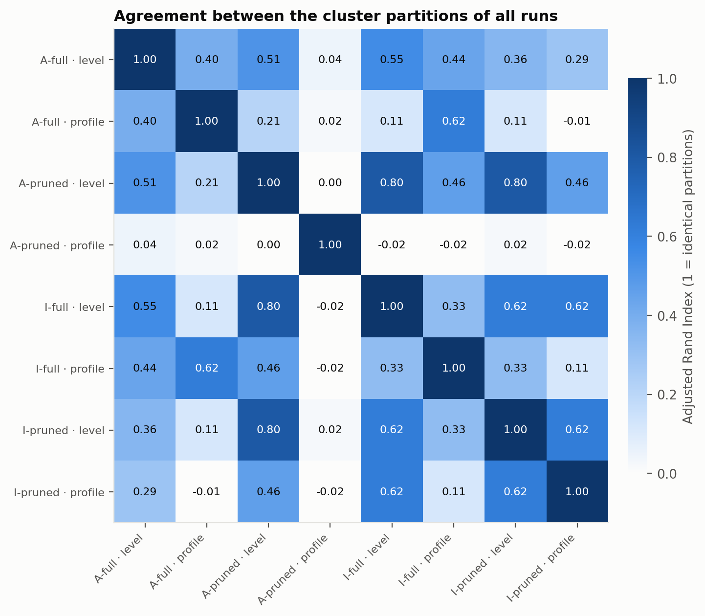

* **Pruning changes even less** (disparity 0.02–0.03 in the level view).
* **The profile view is more sensitive.** The 40 added subindicators are mostly FH and IDA, so they shift each country's balance between
  strategy and capabilities. Profile clusters were not supported anyway, so these results remain exploratory.

---

## Repository layout

```
data/raw/            original workbook (unchanged)
data/processed/      codebook, masked and imputed scores, the four configuration matrices
src/ilia_explore/    data.py · pruning.py · pca.py · clustering.py · pipeline.py · plots.py
notebooks/           01_data_and_missingness · 02_correlation_pruning · 03_pca · 04_clustering · 05_real_vs_imputed
figures/             every figure as PNG, prefixed by notebook number and configuration
results/             tables behind every figure; one folder per configuration and view, plus pruning/ and comparisons/
```

The README shows a selection of figures; [`figures/`](figures/) has all 100, including every configuration and view.

## Reproducing

```bash
python3 -m venv .venv
.venv/bin/pip install -r requirements.txt
cd notebooks
for f in 0*.ipynb; do ../.venv/bin/jupyter nbconvert --to notebook --execute --inplace "$f"; done
```

Notebooks must run in order (each reads what the previous one wrote). All random steps are seeded, so results are identical between runs.
Notebook 04 takes about 4 minutes because of the bootstrap.
